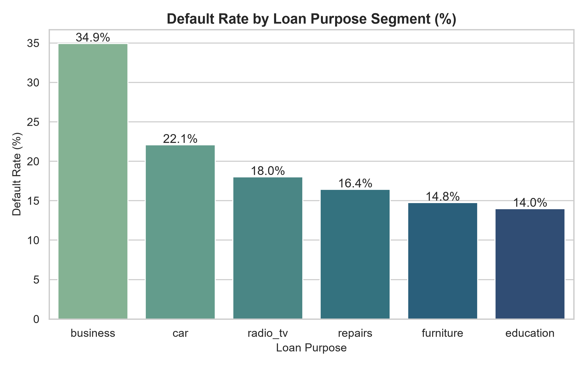
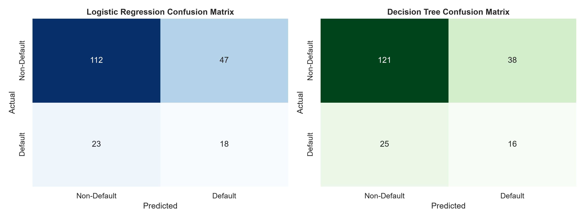
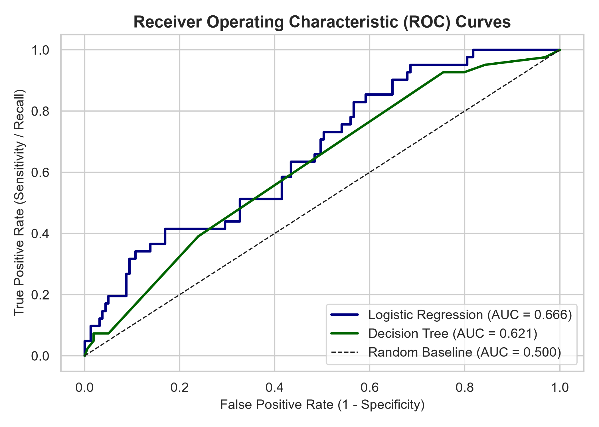
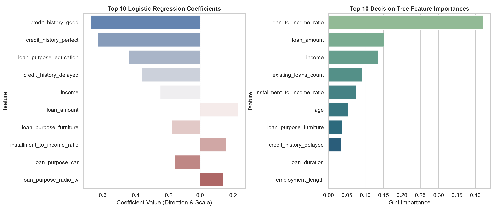

# Loan Default Risk Analysis & Predictive Modeling

An end-to-end data analytics and credit risk modeling project designed to evaluate loan portfolio default probabilities, identify high-risk borrower segments, and build machine learning classifiers for underwriting decisions.

---

## Executive Summary & Problem Statement

Commercial banks lose substantial capital due to Non-Performing Assets (NPAs) when borrowers default on loan obligations. Early identification of credit default risk enables financial institutions to:
- Tighten credit underwriting rules for high-risk applicant segments.
- Optimize risk-based interest pricing.
- Minimize portfolio loss while expanding loan origination safely.

This project implements a complete data pipeline: generating realistic loan records, storing them in a 3NF relational SQLite database, executing analytical SQL queries, engineering risk features, and training machine learning classification models (Logistic Regression & Decision Tree).

---

## Entity-Relationship (ER) Diagram

```mermaid
erdiagram
    BORROWERS ||--o{ LOANS : "holds"
    LOANS ||--|| REPAYMENT_STATUS : "tracks"

    BORROWERS {
        int borrower_id PK
        int age
        real income
        int employment_length
    }

    LOANS {
        int loan_id PK
        int borrower_id FK
        real loan_amount
        int loan_duration
        string loan_purpose
        string credit_history
        int existing_loans_count
    }

    REPAYMENT_STATUS {
        int repayment_id PK
        int loan_id FK
        int default_flag
        int missed_payments_count
    }
```

---

## Tech Stack

- **Language:** Python 3.12+
- **Database:** SQLite3
- **Data Processing:** Pandas, NumPy
- **Machine Learning:** Scikit-Learn (LogisticRegression, DecisionTreeClassifier, StandardScaler)
- **Data Visualization:** Matplotlib, Seaborn
- **Environment:** Jupyter Notebook, VS Code / Antigravity IDE

---

## Folder Structure

```text
loan default risk analysis/
│
├── data_prep.py                  # synthetic data generation, cleaning & sqlite db population
├── analysis.sql                  # 15 structured sql risk analytics queries
├── run_queries.py                # python runner to execute and display sql query tables
├── model.py                      # feature engineering, model training, evaluation & chart saving
├── create_notebook.py            # script to generate jupyter notebook
├── loan_default_analysis.ipynb   # interactive jupyter notebook walkthrough
├── loan_risk.db                  # sqlite database storing borrowers, loans & repayment tables
│
├── chart_default_rate_by_segment.png
├── chart_confusion_matrices.png
├── chart_roc_curves.png
└── chart_feature_importances.png
```

---

## How to Run the Project

1. **Clone or open project directory:**
   ```bash
   cd "loan default risk anlysis"
   ```

2. **Install required Python dependencies:**
   ```bash
   pip install pandas numpy scikit-learn matplotlib seaborn jupyter
   ```

3. **Step 1: Data Preparation & Database Setup:**
   ```bash
   python data_prep.py
   ```
   *Generates 1,000 clean records and populates `loan_risk.db`.*

4. **Step 2: Run SQL Analysis Queries:**
   ```bash
   python run_queries.py
   ```
   *Executes all 15 SQL queries and prints formatted tables in terminal.*

5. **Step 3: Train Models & Generate Charts:**
   ```bash
   python model.py
   ```
   *Trains ML classifiers, prints evaluation metrics, and saves chart images.*

6. **Step 4: Launch Interactive Jupyter Notebook:**
   ```bash
   jupyter notebook loan_default_analysis.ipynb
   ```

---

## Key Analytics & Visualizations

### 1. Default Rate by Loan Purpose Segment


### 2. Confusion Matrices


### 3. Receiver Operating Characteristic (ROC) Curves


### 4. Feature Importance & Coefficients


---

## Key Findings

- **Loan Purpose Risk:** Business and Car loans exhibit higher default probabilities compared to Education or Furniture loans.
- **Financial Burden Ratios:** High `loan_to_income_ratio` and `installment_to_income_ratio` are strong positive predictors of default.
- **Credit History Impact:** Applicants with past critical or delayed payments show significantly higher risk scores even when income is moderate.
- **Loan Amount Quartiles:** Default rate scales progressively with loan principal size, peaking in the highest loan amount quartile.

---

## Model Performance Summary

| Model | Accuracy | Precision | Recall | F1-Score | ROC-AUC |
| :--- | :---: | :---: | :---: | :---: | :---: |
| **Logistic Regression** | 65.00% | 27.69% | 43.90% | 33.96% | **0.6657** |
| **Decision Tree** | 68.50% | 29.63% | 39.02% | 33.68% | 0.6206 |

---

## Project Limitations

1. **Synthetic Dataset:** Synthetic distributions may not capture all real-world macroeconomic correlations (e.g., inflation rates, regional economic downturns).
2. **Static Snapshot:** Data represents a cross-sectional snapshot rather than dynamic time-series repayment behavior over time.
3. **Class Imbalance:** Default events represent a minority class, requiring careful threshold tuning.
4. **Coarse Categoricals:** Credit history categories are simplified compared to comprehensive CIBIL/bureau credit scores.
5. **No Macroeconomic Indicators:** Interest rate fluctuations and employment market conditions are not explicitly included.

---

## What I Learned

- **Database Normalization (3NF):** Designing clean entity-relationship schemas to avoid data redundancy and maintain referential integrity.
- **Advanced SQL Querying:** Mastery of window functions (`RANK`, `DENSE_RANK`, `SUM() OVER`, `NTILE`), CTEs, conditional aggregations (`CASE WHEN`), and subqueries.
- **Credit Risk Modeling:** Engineering financial ratios (`loan-to-income`, `installment-to-income`) that directly drive risk differentiation.
- **Evaluation Beyond Accuracy:** Understanding why Accuracy is misleading in imbalanced datasets and prioritizing ROC-AUC, Recall, and Precision.
- **Model Explainability:** Leveraging Logistic Regression coefficients for auditable underwriting decisioning in banking environments.
